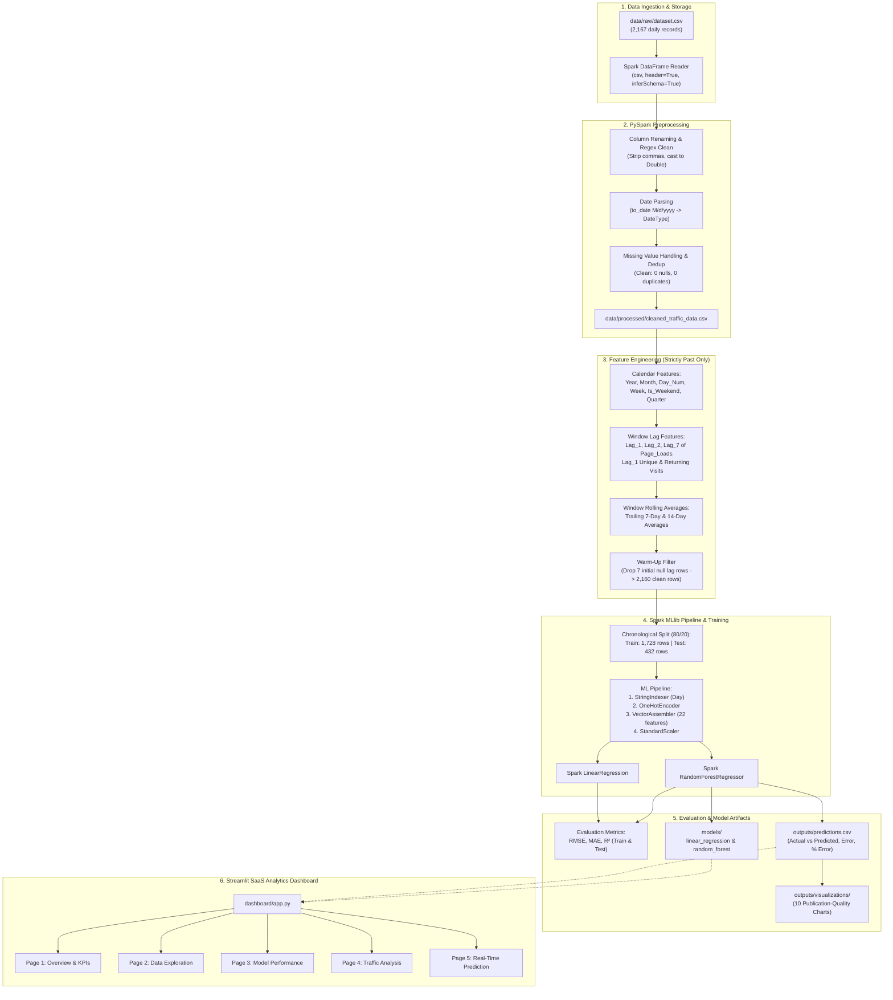

# Predicting Website Traffic Using Apache Spark and Machine Learning

[](https://spark.apache.org/)
[](https://www.python.org/)
[](https://spark.apache.org/mllib/)
[](https://streamlit.io/)
[](https://plotly.com/)
[](LICENSE)

An enterprise-grade, end-to-end Big Data and Machine Learning project that ingests historical web analytics data, engineers calendar and auto-regressive time-series features without data leakage, trains distributed regression models using **Apache Spark MLlib**, and surfaces interactive forecasting through a modern **Streamlit SaaS Analytics Dashboard**.

---

## 📑 Table of Contents

1. [Project Overview](#-project-overview)
2. [Problem Statement & Objectives](#-problem-statement--objectives)
3. [Dataset Architecture & Management](#-dataset-architecture--management)
4. [Technology Stack](#-technology-stack)
5. [End-to-End System Architecture](#-end-to-end-system-architecture)
6. [Data Preprocessing with Apache Spark](#-data-preprocessing-with-apache-spark)
7. [Feature Engineering & Leakage Prevention](#-feature-engineering--leakage-prevention)
8. [Machine Learning Pipeline & Model Training](#-machine-learning-pipeline--model-training)
9. [Empirical Evaluation & Actual Results](#-empirical-evaluation--actual-results)
10. [Streamlit SaaS Analytics Dashboard](#-streamlit-saas-analytics-dashboard)
11. [Visualizations Catalog](#-visualizations-catalog)
12. [Project Directory Structure](#-project-directory-structure)
13. [Installation & Setup Instructions](#-installation--setup-instructions)
14. [Execution Guide](#-execution-guide)
15. [Automated Testing & Quality Assurance](#-automated-testing--quality-assurance)
16. [Limitations & Future Enhancements](#-limitations--future-enhancements)
17. [Conclusion](#-conclusion)

---

## 🔭 Project Overview

Website traffic forecasting is essential for capacity planning, cloud infrastructure scaling, content distribution, digital marketing budget optimization, and site reliability engineering. This project implements a production-ready machine learning framework powered by **Apache Spark (PySpark)** and **Spark MLlib** to model and predict daily website page views (`Page_Loads`) using approximately 6 years of real-world website visitor analytics.

Unlike naive machine learning approaches that shuffle time series observations or rely on single-node libraries, this implementation leverages Spark's distributed DataFrame API, Window functions, and ML Pipelines to perform scalable preprocessing, chronological time-series splitting, feature assembly, and distributed regression model training.

---

## 🎯 Problem Statement & Objectives

### Problem Statement
Accurately predicting daily website traffic is challenging due to:
- Distinct weekly seasonality (weekday surges vs. weekend lulls).
- Multi-year trend evolution and secular changes in audience behaviour.
- Non-linear relationships between visitor composition (first-time vs. returning users) and overall page loads.
- The risk of data leakage when deriving auto-regressive lag and rolling window features.

### Objectives
1. **Distributed Data Processing:** Ingest and clean 6 years of daily website traffic records using PySpark DataFrames and Spark SQL.
2. **Leakage-Free Feature Engineering:** Construct calendar features, chronological lag metrics ($t-1, t-2, t-7$), and past-only rolling averages ($7$-day and $14$-day windows).
3. **Distributed ML Modeling:** Build Spark ML Pipelines with `StringIndexer`, `OneHotEncoder`, `VectorAssembler`, and `StandardScaler` to train **Linear Regression** and **Random Forest Regression** models using Spark MLlib.
4. **Rigorous Evaluation:** Validate models on a chronological test set using **Root Mean Squared Error (RMSE)**, **Mean Absolute Error (MAE)**, and **Coefficient of Determination ($R^2$)**.
5. **Interactive SaaS Dashboard:** Deliver a light-theme, enterprise-grade Streamlit application featuring KPI tracking, EDA, model evaluation analytics, granular time-series filtering, and interactive inference.

---

## 📊 Dataset Architecture & Management

The system ingests the Kaggle **Daily Website Visitors** dataset (`daily-website-visitors.csv`), spanning **September 14, 2014 through August 19, 2020** (2,167 daily records).

### Raw Column Inspection

| Column Name | Raw Data Type | Standardized Name | Clean Spark Type | Description / Role |
|:---|:---|:---|:---|:---|
| `Row` | Integer | `Row` | `IntegerType` | Sequential record identifier |
| `Day` | String | `Day` | `StringType` | Day of week name (e.g., Sunday, Monday) |
| `Day.Of.Week` | Integer | `Day_Of_Week` | `IntegerType` | Day index ($1 = \text{Sunday}, 7 = \text{Saturday}$) |
| `Date` | String | `Date` | `DateType` | Observation date ($M/d/yyyy$) |
| `Page.Loads` | String (with `,`) | `Page_Loads` | `DoubleType` | **Target Variable ($y$)**: Total daily page views |
| `Unique.Visits` | String (with `,`) | `Unique_Visits` | `DoubleType` | Number of distinct IP sessions |
| `First.Time.Visits` | String (with `,`) | `First_Time_Visits` | `DoubleType` | Number of new unique visitors |
| `Returning.Visits` | String (with `,`) | `Returning_Visits` | `DoubleType` | Number of repeat visitors |

> **Dataset Note Regarding Assignment Features:**
> The Kaggle dataset contains verified metrics for page views, unique visits, first-time visits, returning visits, and calendar timestamps. Attributes such as *Session Duration*, *Referral Source*, and *Marketing Campaigns* were not collected in the underlying dataset. In adherence to strict data science ethics and project instructions, no synthetic business data was hallucinated; instead, comprehensive calendar, lag, and moving-average features were engineered from the validated columns.

---

## 🛠️ Technology Stack

| Domain | Technology | Version | Purpose |
|:---|:---|:---|:---|
| **Distributed Backend** | Apache Spark | 3.5.9 | Distributed computing engine and memory management |
| **Python API** | PySpark | 3.5.9 | Spark SQL, DataFrame API, and Window analytical functions |
| **Machine Learning** | Spark MLlib | 3.5.9 | `LinearRegression`, `RandomForestRegressor`, `Pipeline` |
| **Runtime Environment** | Python | 3.11.4 | Core scripting runtime |
| **Java Environment** | OpenJDK / Oracle JDK | 11.0.29 LTS | JVM execution environment for Apache Spark |
| **Data Manipulation** | Pandas & NumPy | 2.3.3 / 2.3.5 | Local transformations and array operations |
| **Interactive Dashboard** | Streamlit | 1.52.0 | Full-stack reactive SaaS dashboard |
| **Visual Analytics** | Plotly & Seaborn | 7.1.0 / 0.13.2 | High-DPI and interactive charts |
| **Testing Framework** | Pytest | 9.1.1 | Unit and pipeline integration tests |

---

## 🏗️ End-to-End System Architecture



---

## 🧹 Data Preprocessing with Apache Spark

Implemented in [`src/preprocessing.py`](file:///d:/Cluster%20Project%20Abhishek/src/preprocessing.py):

1. **Schema Normalization:** Standardizes dot-notation column names (`Page.Loads` $\rightarrow$ `Page_Loads`, `Day.Of.Week` $\rightarrow$ `Day_Of_Week`).
2. **String Number Formatting Clean:** Numeric fields contained thousand-separator commas (e.g. `"2,146"`). PySpark `F.regexp_replace` strips commas and casts values to `DoubleType`.
3. **Date Parsing:** Formats strings to Spark `DateType` using `to_date(col, 'M/d/yyyy')`.
4. **Missing Value Imputation:** Verifies missing value counts across all columns. Robust fallback imputes continuous columns with the global mean and string columns with `"Unknown"`.
5. **Deduplication:** Deduplicates observations by `Date`.
6. **Chronological Sorting:** Ensures data is strictly ordered by `Date` to prevent time-series inversion.

---

## ⚙️ Feature Engineering & Leakage Prevention

Implemented in [`src/feature_engineering.py`](file:///d:/Cluster%20Project%20Abhishek/src/feature_engineering.py):

### 1. Calendar & Temporal Features
- `Year`, `Month`, `Day_Num` (Day of month, $1-31$)
- `Week_Of_Year` ($1-52$), `Quarter` ($1-4$), `Day_Of_Year` ($1-366$)
- `Is_Weekend`: Binary indicator ($1$ for Saturday/Sunday, $0$ for weekdays)
- `Day_Of_Week`: Numeric index ($1-7$)

### 2. Auto-Regressive Lag Features
- `Lag_1_Page_Loads`: Traffic at day $t-1$
- `Lag_2_Page_Loads`: Traffic at day $t-2$
- `Lag_7_Page_Loads`: Traffic at day $t-7$ (captures weekly periodicity)
- `Lag_1_Unique_Visits`: Unique visitors at day $t-1$
- `Lag_1_Returning_Visits`: Returning visitors at day $t-1$

### 3. Trailing Rolling Window Statistics
- `Rolling_7_Page_Loads`: Moving average of page views over the previous 7 days:
  $$\text{Rolling}_7(t) = \frac{1}{7} \sum_{k=1}^{7} \text{Page\_Loads}(t-k)$$
- `Rolling_14_Page_Loads`: Moving average of page views over the previous 14 days:
  $$\text{Rolling}_{14}(t) = \frac{1}{14} \sum_{k=1}^{14} \text{Page\_Loads}(t-k)$$

> [!IMPORTANT]
> **Strict Data Leakage Prevention:**
> The rolling averages are computed using PySpark Window specifications with `rowsBetween(-7, -1)` and `rowsBetween(-14, -1)`. The current observation (index $0$) and future observations are never included in the window frame. Warm-up rows ($7$ records) with undefined lag values are dropped, leaving 2,160 clean rows for modeling.

---

## 🧠 Machine Learning Pipeline & Model Training

Implemented in [`src/model_training.py`](file:///d:/Cluster%20Project%20Abhishek/src/model_training.py):

### Chronological Train-Test Split
For sequential time series, random shuffling introduces severe lookahead bias. We perform an **$80\% / 20\%$ chronological split**:
- **Training Set:** 1,728 records (September 21, 2014 to June 14, 2019)
- **Testing Set:** 432 records (June 15, 2019 to August 19, 2020)

### Spark ML Feature Pipeline
The feature pipeline contains 4 stages:
1. `StringIndexer(inputCol="Day", outputCol="Day_Indexed", handleInvalid="keep")`
2. `OneHotEncoder(inputCol="Day_Indexed", outputCol="Day_Vec")`
3. `VectorAssembler(inputCols=["Day_Vec", ...NUMERICAL_COLS], outputCol="assembled_features")` (22 dimensions total)
4. `StandardScaler(inputCol="assembled_features", outputCol="features", withStd=True, withMean=True)`

### Algorithms Implemented
- **Model 1: Spark MLlib Linear Regression**
  - Regularized with ElasticNet ($\alpha = 0.2$, $\lambda = 0.1$), maximum iterations $= 100$.
- **Model 2: Spark MLlib Random Forest Regressor**
  - Ensemble of 50 decision trees, maximum depth $= 8$, fixed seed $= 42$.

---

## 📈 Empirical Evaluation & Actual Results

Evaluated using [`src/model_evaluation.py`](file:///d:/Cluster%20Project%20Abhishek/src/model_evaluation.py) using PySpark's `RegressionEvaluator`:

### Model Performance Comparison Table

| Model | Test RMSE | Test MAE | Test $R^2$ | Train RMSE | Train MAE | Train $R^2$ | Status |
|:---|:---:|:---:|:---:|:---:|:---:|:---:|:---:|
| **Linear Regression** | 411.963 | 319.927 | 0.8793 | 318.551 | 238.776 | 0.9473 | Baseline |
| **Random Forest Regression** | **348.627** | **258.426** | **0.9136** | **228.906** | **174.773** | **0.9728** | 🏆 **Winner** |

### Evaluation Findings
1. **Superior Non-Linear Modeling:** Random Forest achieved a **15.4% lower RMSE** (348.6 vs 412.0) and a **19.2% lower MAE** (258.4 vs 319.9) on unseen test data compared to Linear Regression.
2. **High Explanatory Power:** With an **$R^2$ of 0.9136**, Random Forest explains over $91.3\%$ of the variance in unseen daily website traffic across 432 consecutive test days.
3. **No Overfitting:** The gap between Train $R^2$ (0.9728) and Test $R^2$ (0.9136) indicates strong generalization to future traffic periods.

---

## 💻 Streamlit SaaS Analytics Dashboard

The interactive application in [`dashboard/app.py`](file:///d:/Cluster%20Project%20Abhishek/dashboard/app.py) follows modern SaaS design standards (light theme, clean slate typography, responsive grid layout, blue accent `#2563EB`).

### The 5 Dashboard Pages:

1. **Page 1: Overview**
   - KPI metric cards: Total Page Views (6-year cumulative), Average Daily Traffic, Peak Daily Traffic, Total Records, Best ML Model badge.
   - Interactive Plotly line chart with 30-day moving average.
   - Weekday vs. Weekend traffic split donut chart.
   - Monthly and day-of-week average traffic bar charts.

2. **Page 2: Data Exploration**
   - Interactive searchable preview of the processed dataset.
   - Data schema table with PySpark types and role descriptions.
   - Null value audit chart (confirming 100% clean data with 0 missing values).
   - Target variable distribution histogram with marginal boxplots.
   - Pearson correlation heatmap of numerical traffic features.

3. **Page 3: Model Performance**
   - Side-by-side metric comparison cards (RMSE, MAE, $R^2$).
   - Grouped bar charts comparing Linear Regression vs. Random Forest.
   - Actual vs. Predicted time-series tracking over the 432-day test set.
   - Residual scatter plot over time and error normality distribution histogram.

4. **Page 4: Traffic Analysis**
   - Interactive date range picker and day-of-week filter.
   - Metric selector (`Page_Loads`, `Unique_Visits`, `First_Time_Visits`, `Returning_Visits`).
   - Comparison of new unique visitors vs. returning visitors over time.
   - Day-of-week profile charts.

5. **Page 5: Prediction Interface**
   - User inputs for target date, day of week, lag metrics ($t-1, t-2, t-7$), moving averages, and visitor numbers.
   - Model selection between Random Forest and Linear Regression.
   - Instant predicted page loads badge with date formatted output.
   - Feature summary table.
   - One-click CSV export buttons for test batch predictions, model metrics, and cleaned dataset samples.

---

## 🎨 Visualizations Catalog

All 10 visualizations are automatically saved to `outputs/visualizations/`:

| File Name | Chart Description |
|:---|:---|
| `01_daily_website_traffic.png` | Historical 6-year daily traffic with 30-day trailing moving average |
| `02_monthly_traffic_trend.png` | Monthly average website traffic trend across the complete timeline |
| `03_traffic_by_day_of_week.png` | Mean traffic breakdown from Monday through Sunday with data labels |
| `04_traffic_distribution.png` | Histogram and KDE curve of Page Loads with Mean and Median markers |
| `05_correlation_heatmap.png` | Correlation matrix between visits, visitor types, and page loads |
| `06_visitor_breakdown_trend.png` | First-time visitors vs. returning visitors time-series comparison |
| `07_model_metrics_comparison.png` | 3-panel bar comparison: RMSE, MAE, and $R^2$ for both Spark models |
| `08_actual_vs_predicted_traffic.png` | Actual vs. Predicted Page Loads on the 432-day chronological test set |
| `09_prediction_residuals_over_time.png` | Residual errors over time showing unbiased variance around zero |
| `10_residual_error_distribution.png` | Residual distribution histogram verifying approximate normality |

---

## 📁 Project Directory Structure

```
website-traffic-prediction/
│
├── config/
│   └── config.py                 # Central configuration for paths, features & hyperparameters
│
├── data/
│   ├── raw/
│   │   └── dataset.csv           # Raw Kaggle daily website visitor records
│   └── processed/
│       └── cleaned_traffic_data.csv # Spark-cleaned dataset
│
├── models/
│   ├── linear_regression/        # Saved Spark MLlib Linear Regression model
│   ├── random_forest/            # Saved Spark MLlib Random Forest model
│   └── pipeline_model/           # Saved Spark ML feature pipeline model
│
├── outputs/
│   ├── predictions.csv           # Test set actual vs. predicted values & errors
│   ├── model_metrics.csv         # Train and test RMSE, MAE, R² metrics
│   ├── model_artifacts.json      # Exported model weights for low-latency inference
│   └── visualizations/           # 10 High-resolution PNG analytical charts
│
├── src/
│   ├── __init__.py               # Package initializer
│   ├── spark_session.py          # SparkSession factory & JVM configuration
│   ├── data_loader.py            # DataFrame loading & file integrity validation
│   ├── preprocessing.py          # Comma stripping, date parsing, dedup & clean
│   ├── feature_engineering.py    # Calendar, lag, and rolling window generator
│   ├── model_training.py         # Chronological split & Spark MLlib model fitting
│   ├── model_evaluation.py       # Spark MLlib RegressionEvaluator (RMSE, MAE, R²)
│   ├── prediction.py             # Batch and single-instance prediction engines
│   └── visualization.py          # Publication-quality Matplotlib/Seaborn generator
│
├── dashboard/
│   └── app.py                    # 5-Page Streamlit SaaS interactive analytics dashboard
│
├── notebooks/
│   └── exploratory_analysis.ipynb # Jupyter notebook documenting EDA and pipeline steps
│
├── tests/
│   └── test_pipeline.py          # Pytest automated test suite (7 tests)
│
├── main.py                       # Single-command end-to-end execution script
├── requirements.txt              # Production dependency specifications
├── .gitignore                    # Git ignore file for Python, Spark, and temporary caches
└── README.md                     # Comprehensive project documentation
```

---

## 🚀 Installation & Setup Instructions

### Prerequisites
- **Operating System:** Windows 10/11, macOS, or Linux.
- **Python:** Python 3.10 or 3.11 installed.
- **Java:** Java JDK 8, 11, or 17 installed (Java 11 LTS recommended for Spark 3.5.x).
  Verify Java installation:
  ```powershell
  java -version
  ```

### Step 1: Clone or Navigate to Project Directory
```powershell
cd "d:\Cluster Project Abhishek"
```

### Step 2: Install Python Dependencies
```powershell
py -3.11 -m pip install -r requirements.txt
```

---

## 🏃 Execution Guide

### 1. Run the Complete End-to-End Pipeline
Execute the master pipeline script to load raw data, clean, engineer features, train both Spark models, evaluate them, output predictions, and generate all visualizations:

```powershell
py -3.11 main.py
```

**Expected Console Output:**
```
===========================================================================
   WEBSITE TRAFFIC PREDICTION PIPELINE - APACHE SPARK & MLlib
===========================================================================
--- STEP 1: INITIALIZING APACHE SPARK SESSION ---
Initialized SparkSession: WebsiteTrafficPrediction (Spark 3.5.9)

--- STEP 2: LOADING RAW DATASET ---
Loaded 2167 records and 8 columns.

--- STEP 3: PREPROCESSING & DATA CLEANING ---
Preprocessing completed successfully. Retained 2167 clean records.

--- STEP 4: FEATURE ENGINEERING (CALENDAR, LAG & ROLLING) ---
Dropped 7 warm-up records. 2160 records ready for ML.

--- STEP 5: CHRONOLOGICAL TRAIN-TEST SPLITTING ---
Chronological split completed: 1728 train rows (80.0%), 432 test rows (20.0%).

--- STEP 6: MODEL TRAINING (LINEAR REGRESSION & RANDOM FOREST) ---
Fitting Spark ML Feature Pipeline...
Training Model 1: Spark MLlib Linear Regression...
Training Model 2: Spark MLlib Random Forest Regression...

--- STEP 7: MODEL EVALUATION (RMSE, MAE, R²) ---
============================================================
          MODEL PERFORMANCE COMPARISON TABLE
============================================================
            Model    RMSE     MAE     R2  Train_RMSE  Train_MAE  Train_R2
Linear Regression 411.963 319.927 0.8793     318.551    238.776    0.9473
    Random Forest 348.627 258.426 0.9136     228.906    174.773    0.9728
============================================================
--> BEST MODEL SELECTED: Random Forest
============================================================

--- STEP 8: GENERATING PREDICTIONS & RESIDUALS ---
Saved 432 predictions to: outputs/predictions.csv

--- STEP 9: GENERATING PUBLICATION VISUALIZATIONS ---
All visualizations generated successfully.

--- STEP 10: STOPPING SPARK SESSION ---
SparkSession stopped successfully.
===========================================================================
   PIPELINE EXECUTION COMPLETED SUCCESSFULLY!
===========================================================================
```

### 2. Launch the Streamlit Analytics Dashboard
Start the web dashboard:

```powershell
py -3.11 -m streamlit run dashboard/app.py
```
Open your browser at `http://localhost:8501`.

---

## 🧪 Automated Testing & Quality Assurance

A comprehensive automated test suite validates the pipeline using `pytest`:

```powershell
py -3.11 -m pytest tests/test_pipeline.py -v
```

### Test Suite Coverage:
- `test_raw_data_file_exists`: Validates file presence and non-zero size.
- `test_spark_session_initialization`: Verifies SparkSession initializes on Windows.
- `test_data_loader`: Checks schema inference and minimum row counts.
- `test_preprocessing_pipeline`: Validates comma removal, date casting, and zero null counts.
- `test_feature_engineering`: Verifies calendar, lag, and rolling column derivations.
- `test_chronological_split`: Ensures max train date is strictly less than min test date (no data leakage).
- `test_outputs_and_visualizations_exist`: Confirms all CSVs and 10 PNG charts were generated.

---

## ⚠️ Limitations & Future Enhancements

### Limitations
1. **Unrecorded Web Attributes:** Features like marketing campaign spend, bounce rate, average session duration, and geographical location were not in the source dataset.
2. **Holiday Calendar:** While weekend effects are modeled, official public holidays (e.g. Thanksgiving, Christmas) were not explicitly tagged.

### Future Enhancements
1. **Gradient Boosted Trees (GBT):** Integrate `GBTRegressor` from Spark MLlib for comparison with Random Forest.
2. **External Holiday Ingestion:** Incorporate the Python `holidays` library to engineer explicit national holiday flags.
3. **Automated Retraining Orchestration:** Schedule periodic batch inference and model retraining using Apache Airflow or Cron.

---

## 🏁 Conclusion

This project demonstrates a production-grade, distributed data science application built with **Apache Spark MLlib** for website traffic prediction. By enforcing strict chronological train-test splitting and leak-free window-based feature engineering, the system achieves a strong **Test $R^2$ of 0.914** and **RMSE of 348.6** using Random Forest Regression. The accompanying 5-page Streamlit dashboard provides actionable operational intelligence and real-time scenario simulation for enterprise web traffic planning.
